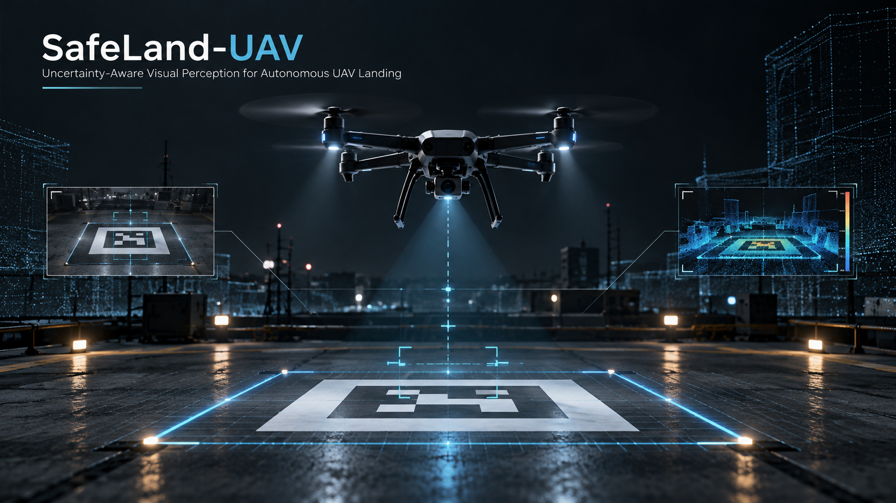

# SafeLand-UAV

<p align="center">
  
</p>

### Uncertainty-Aware Visual Perception for Autonomous UAV Landing

> **Status:** Work in Progress 🚧  
> Currently working on the visual landing simulation.

SafeLand-UAV is a personal research project on autonomous UAV landing using visual perception and predictive uncertainty.

The main idea is simple: a landing system should not only detect where it can land, but should also be able to recognize when its visual prediction is not reliable enough to make a safe landing decision.

The project is being developed completely in simulation first, using PX4 and Gazebo.

## Research Question

**Can predictive uncertainty help reduce unsafe autonomous landing decisions when the visual conditions are different from those seen during development or training?**

Examples include poor lighting, blur, noise, partial occlusion, and changes in the appearance or position of the landing target.

## Project Idea

The final system is planned around the following pipeline:

```text
Simulated UAV + RGB Camera
          ↓
Landing Target Detection
          ↓
Uncertainty Estimation
          ↓
Safe / Unsafe Landing Decision
          ↓
PX4 Flight Control
          ↓
Autonomous Landing
```

The project will be built step by step. I first want to establish a reliable simulation and perception pipeline before introducing the learning-based parts.

## Current Progress

The basic UAV simulation is now running successfully.

So far, I have set up:

- PX4 SITL
- Gazebo
- x500 quadrotor simulation
- QGroundControl connection through MAVLink
- simulated IMU, GPS, magnetometer, and barometer data
- PX4 state estimation and preflight checks

The first complete flight test has also been completed successfully:

```text
Preflight Check
      ↓
Arm
      ↓
Takeoff
      ↓
Flight
      ↓
Landing
      ↓
Automatic Disarm
```

This gives me a working baseline before adding the camera and landing-target detection.

## Tools

Currently used:

- PX4 SITL
- Gazebo
- QGroundControl
- MAVLink
- Python
- Git/GitHub

Planned for the next stages:

- OpenCV
- PyTorch
- ROS 2
- NumPy / pandas
- Matplotlib

For uncertainty estimation, I plan to experiment with methods such as Monte-Carlo Dropout and Deep Ensembles.

## Evaluation

Once the perception and landing pipeline is working, I plan to test it under different conditions, including:

- different illumination levels
- image noise and blur
- partial occlusion of the landing target
- different camera poses
- wind disturbances
- landing configurations not seen during training

The main metrics will include detection accuracy, landing error, landing success rate, unsafe landing rate, uncertainty calibration, and runtime.

## Baselines

The current plan is to compare:

1. Classical computer-vision approach
2. Neural visual detector
3. Neural detector with uncertainty estimation
4. Uncertainty-aware landing decision system

This should make it possible to measure whether adding uncertainty estimation actually improves landing safety.

## Roadmap

- [x] **Phase 0 — Project and environment setup**
- [x] **Phase 1 — PX4/Gazebo UAV simulation baseline**
- [ ] **Phase 2 — RGB camera and landing-target dataset generation** ← Current
- [ ] **Phase 3 — Classical computer-vision baseline**
- [ ] **Phase 4 — PyTorch visual detector**
- [ ] **Phase 5 — Uncertainty estimation**
- [ ] **Phase 6 — Autonomous landing decision/control integration**
- [ ] **Phase 7 — Robustness tests and ablation study**
- [ ] **Phase 8 — Final documentation, demo, and technical report**

## Repository Structure

```text
SafeLand-UAV/
├── assets/                 # figures and demo media
├── configs/                # simulation and experiment configurations
├── docs/                   # notes and documentation
├── src/
│   └── safeland/
│       └── __init__.py
├── tests/
├── .gitignore
├── README.md
└── ROADMAP.md
```

## What I'm Working on Now

The next step is to add a downward-facing RGB camera to the simulated UAV and create a landing target in Gazebo.

The immediate goal is:

```text
x500 UAV
   ↓
Downward-Facing Camera
   ↓
Landing Target
   ↓
RGB Images
```

Once this is working reliably, I can start with a simple computer-vision baseline before moving to the neural detector and uncertainty estimation.

PX4 is kept separately as an external dependency. This repository contains the SafeLand-specific perception, decision-making, evaluation, and integration code.

## Author

**Faraz Firouzbakht**  
M.Sc. Mechanical Engineering — Robotics & AI  
Karlsruhe Institute of Technology (KIT)

GitHub: https://github.com/farazfiro